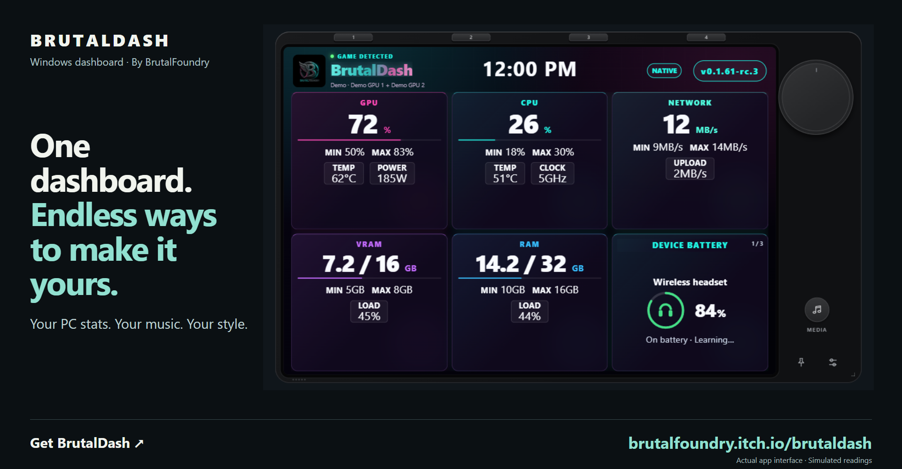
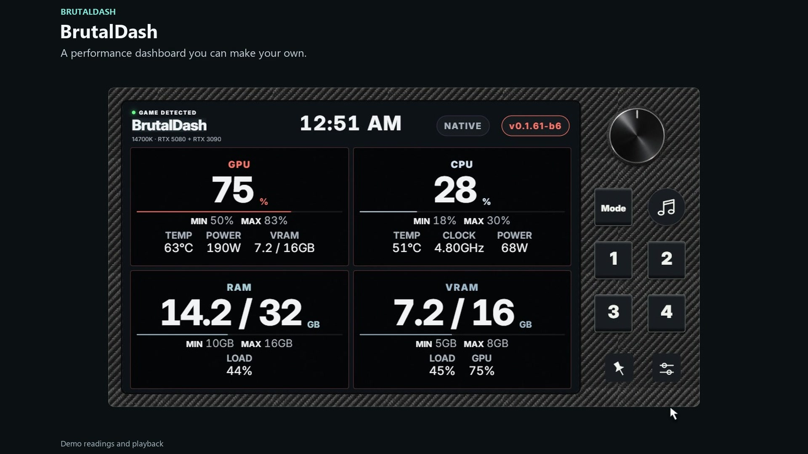
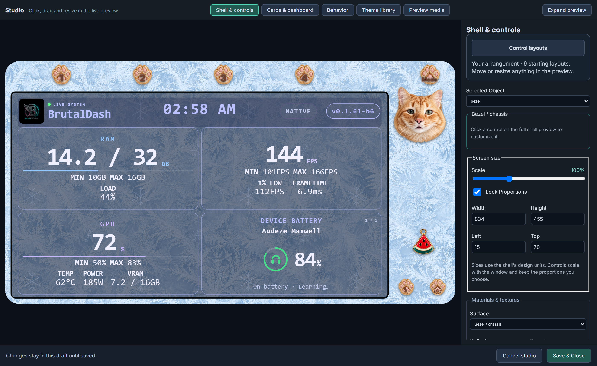
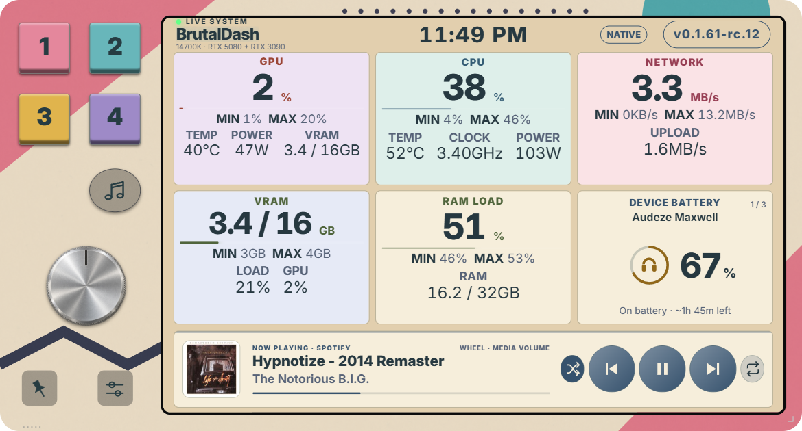
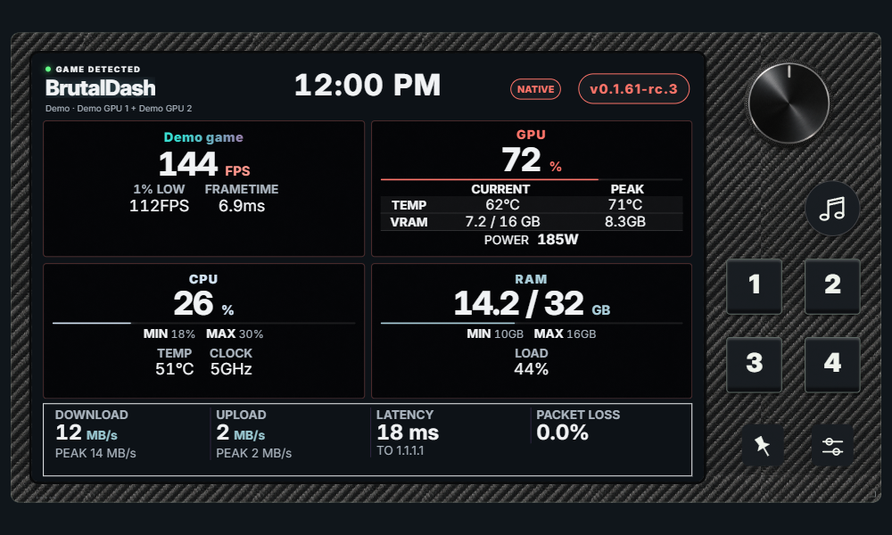
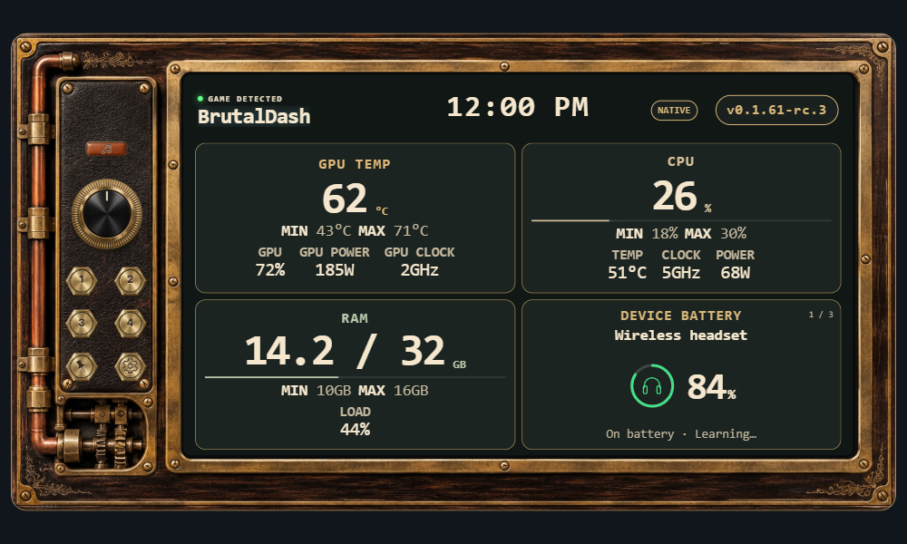
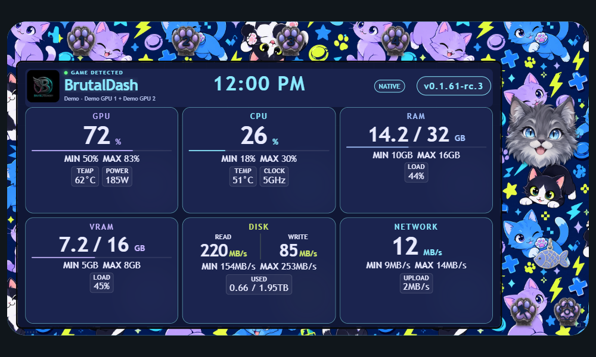
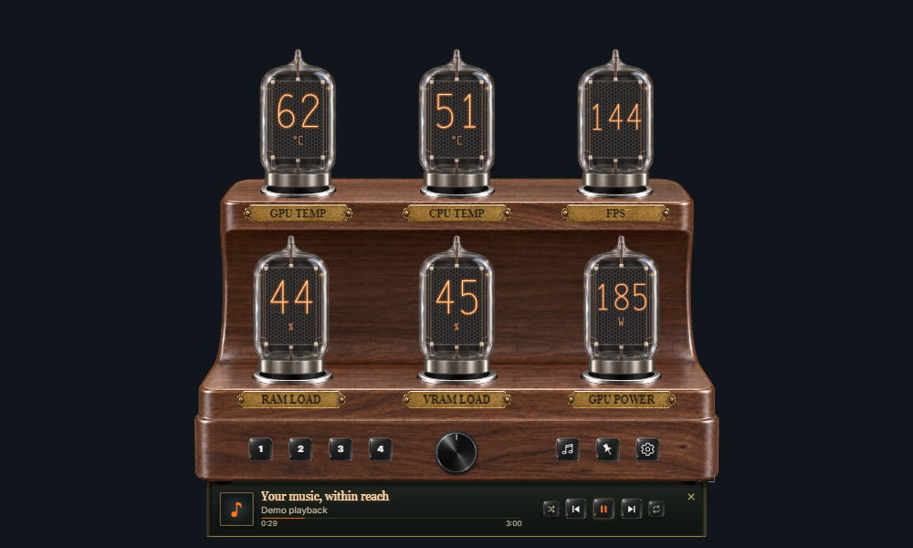

# BrutalDash

**Your PC stats. Your music. Your style.**

**[Get BrutalDash for Windows · US$4.99](https://brutalfoundry.itch.io/brutaldash)**  
One purchase. No subscription. Full refund within 14 days for any reason.

### BrutalDash is for everyone.

If the price is out of reach for you, email me personally at [brutal@brutalfoundry.com](mailto:brutal@brutalfoundry.com).

## See it in action

**[Watch the showcase](https://www.youtube.com/watch?v=dDEDTy5b1Y8)**

## About BrutalDash

Turn your system readings into part of your setup. BrutalDash brings game stats, music and personal style together in a Windows dashboard you can make your own.

### Build a look that belongs on your desk

Carbon and metal. Leather and wood. Brass and steam. Cats, paws and snowflakes. Start with a complete theme, then make it yours in Studio.

Arrange the cards. Choose the readings. Change fonts, colors and textures. Move the buttons and dials, or bring in your own pictures. With more than 500 materials and 100 cat faces, paws, snowflakes and charms to choose from, you have plenty of ways to find your look.

Save different views for gaming, work or everyday use. Export your designs to share them or take them to another PC.

### Your game. Your stats. Your layout.

Keep FPS, 1% lows, frame time, temperatures and system activity in view. Use the full dashboard on your desktop, take transparent stats into a windowed or borderless game, or keep it simple with one compact card.

Position your overlay and lock it so clicks pass through to your game. Your chosen stats stay where you want them.

Check battery levels for supported devices and local AI readings from supported sources alongside your PC stats.

### Make room for your music

Bring artwork, track details and playback controls into a player styled to match your panel.

## Find your look. Make it yours.

| Carbon GT | Brass & Steam |
| --- | --- |
|  |  |
| **Neko Arcade** | **Nixie Atelier** |
|  |  |

## Make it yours for US$4.99

**One purchase. No subscription.** The introductory price includes updates released for your purchased major version. Use it on one active PC, with transfer when you change machines.

Try it with confidence: **full refund within 14 days for any reason.**

**[Download. Install. Make it yours.](https://brutalfoundry.itch.io/brutaldash)**

Questions? [support@brutalfoundry.com](mailto:support@brutalfoundry.com)

BrutalDash for Windows · By BrutalFoundry

---

This repository is the public product showcase. The paid Windows application source is private. For the free BridgeThing edition, see [BrutalDash for CarThing](https://github.com/Brutal-BrutalFoundry/BrutalDash-for-CarThing).
